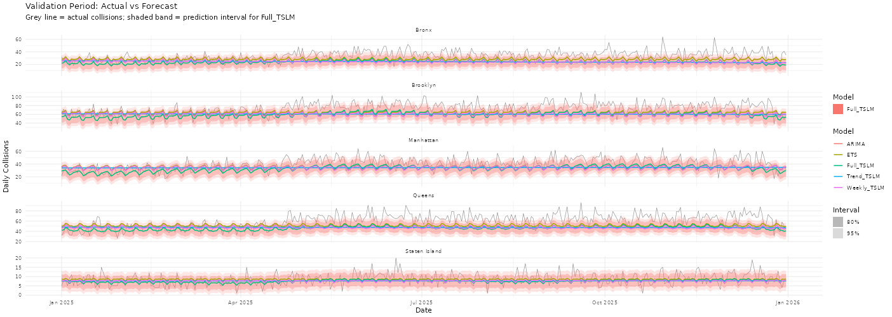

## Part I — Links and Description (required)

-   **Deployed Shiny App URL:** https://pqqjw7-imelda-mendoza.shinyapps.io/nyc-collision-forecasting/

-   **Code URL:** GitHub repository: https://github.com/imendoza-coder/ShinyApp

**App Description:** The Shiny app explores and forecasts daily motor vehicle collisions in New York City using NYC Open Data crash records from 2021 onward. Users select boroughs, set the historical range and the training and validation cutoffs, and choose which of five models to compare (Trend TSLM, Weekly TSLM, Full TSLM, ETS, ARIMA). The app scores each model on the validation period and forecasts forward with 80% and 95% prediction intervals.

**App Features:**

-   Borough selection; each borough is modeled as its own series.
-   User-controlled training and validation end dates and forecast horizon.
-   Forecast plots with actual collisions overlaid as a thin grey line and shaded prediction intervals for a chosen model.
-   Accuracy table (RMSE, MAE, MAPE, ACF1) for training and validation, plus the best model per borough.
-   Residual diagnostics for any model and borough.
-   Overview tab with total, average and maximum daily collisions, and a searchable data explorer.

## Part II — Data Story (≤ 2 pages total)

**Weekday and seasonal structure make daily collisions forecastable, and the best model differs by borough.**

Citywide (five boroughs), daily collisions show a modest weekly cycle, with Fridays about 214 per day against about 181 on Sundays. They also show a larger annual pattern, from about 165 per day in January and February to about 195 in May and June. Models that include seasonality can use both. On the default split (train through 2024, validate on 2025), ETS had the lowest validation RMSE in the Bronx, Brooklyn, Queens and Staten Island, while the Full TSLM (trend, weekday effects and annual Fourier terms) was best in Manhattan. Percentage errors are much larger for small series (for example, Staten Island), because daily counts there are low.

Validation errors also reflect a change in level. Average daily collisions fell from about 198 in 2021 to about 178 in 2024, then rose to about 215 in 2025. Actual collisions therefore ran above most model forecasts in the Bronx and Manhattan during validation, because the trend was learned from the earlier decline. This is a limit of fitting a trend to earlier data, and it is why the training cutoff control matters.

```{r}
#| fig-height: 2.6
library(tidyverse)

read_csv("data/daily_borough_counts.csv", show_col_types = FALSE) |>
  filter(borough != "Unknown") |>
  mutate(month = floor_date(day, "month")) |>
  summarise(crashes = sum(crashes), .by = c(borough, month)) |>
  ggplot(aes(month, crashes, color = borough)) +
  geom_line() +
  labs(x = NULL, y = "Monthly collisions", color = "Borough")
```

{width=75%}

Story board.

1.  Open the app with the default boroughs and all five models, then click Run Forecast Analysis.
    -   On the Model Accuracy tab, compare validation RMSE across models for each borough.
2.  On the Forecasts tab, choose a model under "Show prediction intervals for".
    -   Check how much of the validation-year actuals fall inside the 80% and 95% bands.
3.  Move the training end date later and re-run.
    -   Observe how the validation errors change as the training window changes.
